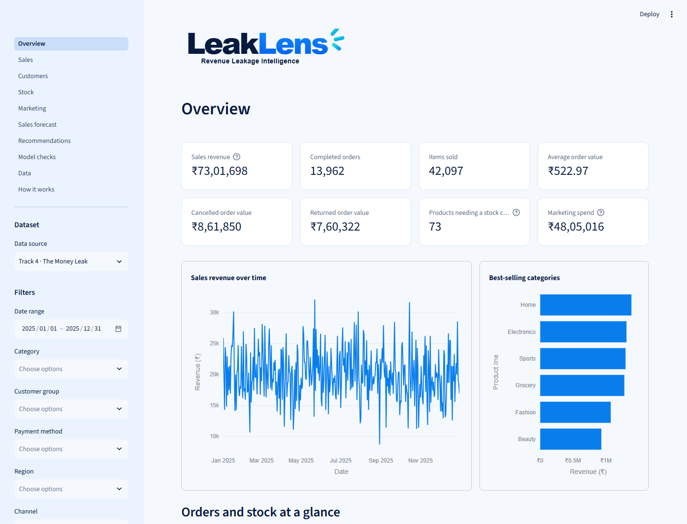
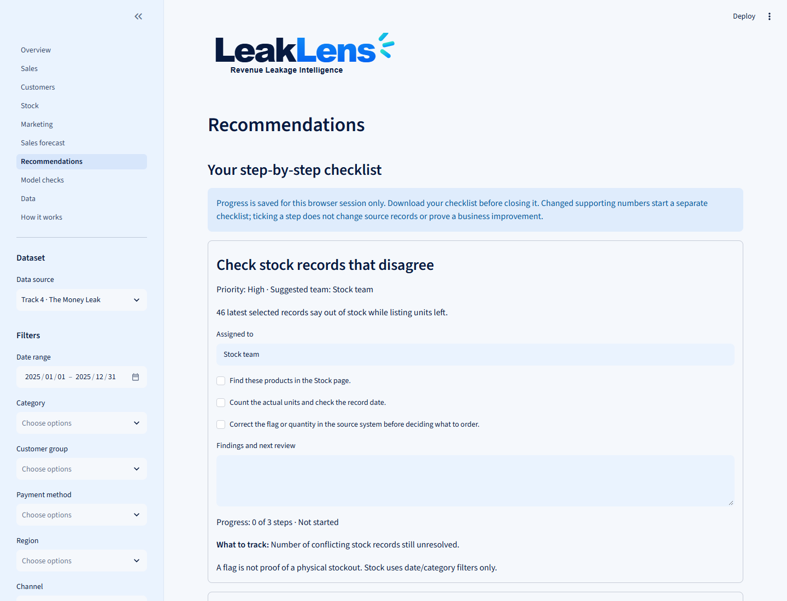
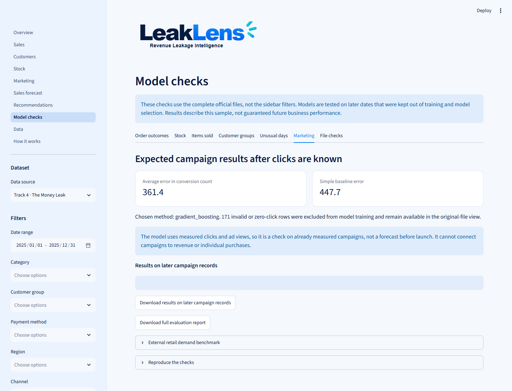
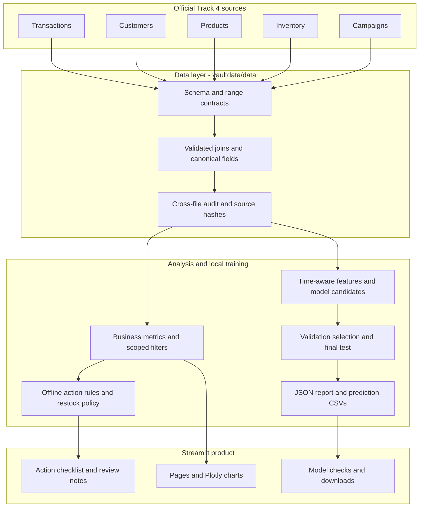
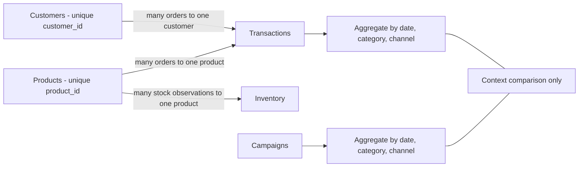
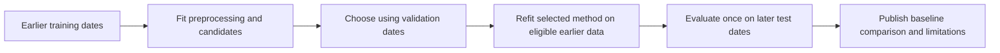

<div align="center">


# NTR · LeakLens

### Find the money leaks. Check the evidence. Take the next step.

**DATATHON 2026 · Track 4: The Money Leak**

Retail decision support built with Streamlit, locally trained models, and all five official datasets.

[Quick start](#quick-start) · [Architecture](#system-architecture) · [Results](#measured-model-results) · [Judging evidence](#judging-rubric--repository-evidence) · [Demo guide](docs/DEMO.md)

</div>

---

## Why LeakLens exists

A retail manager sees cancelled orders, products running low, and rising campaign spend in separate spreadsheets. The difficult part is deciding **which issue deserves attention, whether the records are trustworthy, and what to do next**.

LeakLens connects those records into one workflow:

**Understand performance → investigate a problem → review the evidence → assign actions → track the follow-up.**

It supports business owners, category managers, stock teams, and marketing teams. It extends the original Streamlit dashboard and keeps its supermarket demo and single-CSV upload alongside the official Track 4 data.

| At a glance | Included |
|---|---|
| Official data | **5 files · 27,450 records** |
| Modeling | Order outcomes, next-record stock state, sales forecasts, customer groups, unusual days, campaign results |
| Decisions | Prioritized checklists and guarded restock scenarios |
| Verification | Automated calculation, modeling and UI tests; reproducible evaluation and prediction exports |
| Credentials | **Not required** for the dashboard, local models, forecasts, checks, or action checklist |

## Round 2 reviewer entry point

**Public repository:** [bma11122102-artisssst/business-insights-dashboard](https://github.com/bma11122102-artisssst/business-insights-dashboard) ? **Branch:** `main` ? **Model declaration:** trained from scratch using standard learning libraries; no pretrained weights or hosted inference.

- **Train:** `python train.py --output reports` ? actual estimator fitting is in [`vaultdata/ml/campaigns.py`](vaultdata/ml/campaigns.py), [`order_risk.py`](vaultdata/ml/order_risk.py), [`stock_risk.py`](vaultdata/ml/stock_risk.py), [`customers.py`](vaultdata/ml/customers.py) and [`anomalies.py`](vaultdata/ml/anomalies.py).
- **Load data:** [`vaultdata/data/track4.py`](vaultdata/data/track4.py); validate and split before training in [`vaultdata/ml/common.py`](vaultdata/ml/common.py).
- **Read the results:** [`reports/EVALUATION.md`](reports/EVALUATION.md), prediction CSVs and [`reports/evaluation.json`](reports/evaluation.json).
- **Complete the form:** [field-by-field submission answers and dataset/service declarations](docs/ROUND2_SUBMISSION.md). Personal/team fields must be entered by the team.

The [official Round 2 page](https://datathon-xi.vercel.app/round2.html) specifies repository-only judging, screenshots, training/data-loading code, and declarations. It says the last commit before **4:30 PM IST on 16 October 2026** is judged; later pushes are ignored. No live demonstration is required.

## Product screenshots and sample output

Actual captures of the running Streamlit product using the supplied Track 4 files.

### Business overview



### Evidence-to-action checklist



### Locally trained model results



Sample outputs: [later campaign predictions](reports/campaign_holdout_predictions.csv), [daily item forecasts](reports/daily_units_forecasts.csv), [customer groups](reports/customer_groups.csv) and [restock scenario](reports/restock_scenario.csv). These are generated artifacts, not mock outputs.

## Quick start

**Prerequisite:** Python **3.12**, the tested environment. Run these commands from the repository root.

```bash
python -m venv .venv
```

Activate the environment:

```powershell
# Windows PowerShell
.venv\Scripts\Activate.ps1
```

```bash
# macOS / Linux
source .venv/bin/activate
```

Install and start:

```bash
python -m pip install -r requirements.txt
python -m streamlit run streamlit_app.py
```

Open the local address printed by Streamlit and select **Track 4 · The Money Leak**. The official source files and saved model results are included; no dataset download or model-service key is needed.

For the exact tested package versions, install `requirements-lock.txt` instead of `requirements.txt`. If PowerShell blocks activation, use `.venv\Scripts\python.exe` in place of `python` without activating.

## Product walkthrough

| Page | User question | What it provides |
|---|---|---|
| **Overview** | How is the business doing? | Completed revenue, orders, items sold, average order value, cancellations/returns, marketing spend, trends and visual breakdowns |
| **Sales** | Where should we investigate? | Category, region, channel and customer-group comparisons; order outcomes and weekly changes |
| **Customers** | Who buys and how often? | Repeat buying and independent groups based on actual purchase histories |
| **Stock** | What needs checking or restocking? | Latest recorded quantities, update dates, plain status labels, conflicts and a guarded restock scenario |
| **Marketing** | Are reported results worth reviewing? | Spend, impressions, clicks, reported conversions, cost comparisons and count-quality warnings |
| **Sales forecast** | What sales should we plan around? | Revenue or item estimates, historical comparisons and uncertainty ranges |
| **Recommendations** | What should each team do next? | Evidence, priority, owner assignment, step completion, review notes and a downloadable checklist |
| **Model checks** | Can we trust these estimates? | Baselines, later-date test results, exclusions, limitations and downloadable predictions |
| **Data / How it works** | Where did this number come from? | Original records, validated joins, exports, calculations and assumptions |

**Filter scope:** orders use all sidebar filters; stock uses date/category; campaigns use date/category/channel. Model checks uses the complete official files. The interface distinguishes these scopes so a regional order filter does not imply regional inventory exists.

Checklist progress lasts for the browser session. Changed supporting evidence starts separate progress; completing a step does not alter source records or establish a measured business benefit.

## System architecture



**Two execution paths:** the dashboard loads records and renders interactive analysis; the offline evaluation command trains candidates and saves evidence. Saved model checks are not retrained on each dashboard interaction. Source-hash checks prevent changed files from being presented with stale model evidence.

| Layer | Technology / responsibility |
|---|---|
| Interface | Streamlit multipage app, Plotly charts, reusable components |
| Data and calculations | pandas, NumPy, validated many-to-one joins, source-level auditing |
| Local models | scikit-learn classifiers, regressors, KMeans and IsolationForest; statsmodels Holt-Winters |
| Evidence | JSON metadata, SHA-256 source/artifact hashes and CSV prediction exports |
| Reliability | pytest, Streamlit AppTest, GitHub Actions verification workflow |

## How all five datasets are used

The [official Track 4 files](https://datathon-xi.vercel.app/problem-statements.html#track-4) are preserved under `data/track4/04_business_money_leak/`, including the supplied README.

| Dataset | Rows | Meaningful use |
|---|---:|---|
| `transactions.csv` | 18,000 | Revenue, order outcomes, discounts, daily revenue/items, purchase history, unusual-day features and past booked quantities for stock features |
| `customers.csv` | 3,000 | Customer join, region/profile context, signup checks, preferred-channel comparison and ID-linked buying histories |
| `products.csv` | 250 | Category join, recorded cost/list-price checks, supplier lead times, stock features and restock calculations |
| `inventory.csv` | 5,000 | Latest stock, restock levels, supplier delays, contradictory flags and next-observation labels |
| `campaigns.csv` | 1,200 | Spend/result analysis, invalid-count checks, conversion-count modeling and contextual sales comparison |



Campaigns have **no order-level attribution key**. Both sides are aggregated before their contextual join; campaign revenue and ROAS are not invented. See the [data dictionary](docs/DATA_DICTIONARY.md) and [Track 4 implementation map](docs/TRACK4_ALIGNMENT.md) for field-level roles.

### Additional external-data experiment

We additionally use [UCI Online Retail](https://archive.ics.uci.edu/dataset/352/online+retail), Daqing Chen (2015), [DOI 10.24432/C5BW33](https://doi.org/10.24432/C5BW33), licensed **CC BY 4.0**. Its 541,909 transaction rows are transformed into **374 daily aggregate records**, retaining 530,104 positive-sale rows before aggregation. The committed aggregate contains no customer identifiers.

The demand methods are **independently fitted and evaluated** on this external daily-unit series. This benchmark never changes Track 4 training cohorts, business totals or model selection. It is not a transfer test of a frozen Track 4 model. Source GBP values are kept separate from rupee displays; the benchmark predicts item counts only. The independently selected Holt-Winters model achieved held-out MAE **9,714.42 items**, versus **11,052.43** for the weekly baseline (about **12.1% lower**); this is separate from the Track 4 results. See [external-data provenance and rebuild steps](data/external/uci_online_retail/README.md), [transformation code](scripts/prepare_external_retail.py) and the separate results in Model checks / `reports/EVALUATION.md`.

### Data quality is part of the decision

Contracts check required columns, unique IDs, references, finite numeric values, allowed statuses and dates. The audit additionally found:

| Finding in the original files | Handling |
|---|---|
| 797 orders before listed customer signup | Keep sales records; exclude signup-derived classifier features |
| 760 out-of-stock flags with positive quantities | Show conflicts; block conflicting restock quantities |
| 88 campaigns with conversions above clicks; 84 with clicks above impressions | Keep original records visible; apply the documented model cohort rule |
| 114 repeated product/date stock observations | Collapse deterministically for next-record modeling only |
| 5,315 completed orders below recorded product cost | Explain independently generated prices/costs; avoid audited-profit claims |

The campaign training cohort excludes **171 invalid or zero-click rows**, leaving **1,029** eligible rows. Counts overlap and should not be added together. Raw files remain unchanged.

## Models trained on the provided data

Models are fitted locally using standard learning libraries, without pretrained weights. Training from scratch here means fitting model parameters on the supplied records, rather than calling a hosted predictor. It does not mean reimplementing learning algorithms manually.

| Task | Candidates / method | Evaluation design |
|---|---|---|
| Order outcomes | Prior baseline, logistic regression, gradient boosting | Whole-day chronological 60/20/20; assumed 30-day outcome availability; boundary purging; validation log loss selection |
| Next recorded stock state | Prior baseline, logistic regression, gradient boosting | Past information only; next-record labels; purge labels crossing temporal cutoffs |
| Daily units and revenue | Weekly seasonal baseline, recent mean, Holt-Winters | Two earlier 14-day validation windows; separate final 14-day test |
| Customer grouping | Standardized log-RFM and KMeans | Choose 2–6 groups by silhouette; report group profiles and Davies–Bouldin |
| Unusual days | IsolationForest | Fit earliest 80% of days; inspect later 20%; descriptive deviations accompany flags |
| Campaign conversion counts | Click-rate baseline, Poisson regression, gradient boosting | Chronological validation/test; measured clicks available; count-valid training cohort |
| Restock scenario | Lead-time demand and safety-stock policy | Transparent formula, budget scenario, stale/conflicting-record safeguards; a policy rather than a trained optimizer |



Temporal tasks use their documented task-specific splits. Future labels crossing boundaries are purged where applicable; preprocessing is fitted on training data. Unsupervised diagnostics are reported separately from predictive accuracy. Full definitions: [model cards](docs/MODEL_CARDS.md) and [assumptions](docs/ASSUMPTIONS.md).

## Measured model results

From the included [evaluation report](reports/EVALUATION.md). These results describe the supplied synthetic sample; they do not establish future performance in a real business. **Lower error is better.**

| Held-out task | Selected method | Test error | Baseline error | Error reduction |
|---|---|---:|---:|---:|
| Campaign conversion count | Gradient boosting | 361.37 conversions MAE | 447.68 | 19.3% |
| Daily items, all categories | Recent mean | 14.65 items MAE | 19.57 | 25.1% |
| Daily completed revenue | Recent mean | ₹2,776.65 MAE | ₹3,369.33 | 17.6% |
| Order outcomes | Prior baseline | 0.602720 log loss | 0.602720 | No improvement established |
| Next recorded stock state | Prior baseline | 0.441291 log loss | 0.441291 | No improvement established |

- **Customer grouping:** 2,971 buyers, 2 groups, silhouette **0.366**. This is separation, not 36.6% accuracy.
- **Unusual days:** 10 flags among 73 later days. No confirmed labels exist to estimate detection precision or recall.
- **Forecast uncertainty:** category-level measured coverage of approximate 80% ranges varies, including values below 80%; all results are published.

Order and stock classification retained their baselines, so **individual risk ranking is not supported**. Campaign estimation uses already measured clicks and is a post-measurement diagnostic, not a pre-launch forecast. Forecasts estimate recorded completed sales, not unobserved demand lost during stockouts. The original interactive revenue forecast remains a separate Holt-Winters path; the table above reports the offline validation-selected benchmark.

## Reproduce and inspect the evidence

```bash
python -m pip install -r requirements-lock.txt
python -m pytest -q
python train.py --output artifacts/review
```

After dependency installation, training and evaluation run **offline without credentials**. Use `--output reports` to refresh the saved results shown by Model checks; use `artifacts/review` for an independent run without overwriting the included snapshot.

| Evidence | Location |
|---|---|
| Human-readable measured results | [reports/EVALUATION.md](reports/EVALUATION.md) |
| Features, splits, scores, seeds, versions, exclusions and hashes | [reports/evaluation.json](reports/evaluation.json) |
| Holdout predictions, forecasts, customer groups and restock scenarios | [reports/](reports/) |
| Schema, calculations, temporal leakage, model selection, UI and failure tests | [tests/](tests/) |
| Automated test and offline-evaluation workflow | [.github/workflows/ci.yml](.github/workflows/ci.yml) |

GitHub Actions installs the locked dependencies, runs the tests, rebuilds evaluation and uploads the results. **A workflow is included; a successful remote run must be checked in the submitted repository's Actions tab.** Inspect the actual Actions run for current verification status.

## Judging rubric → repository evidence

Mapped to the [official 100-mark rubric](https://datathon-xi.vercel.app/judging.html), verified 16 October 2026. Weights are the published criteria, not a predicted submission score.

| Criterion | Marks | Where to review |
|---|---:|---|
| Problem understanding & user need | 10 | User scenario, product walkthrough and [Track 4 alignment](docs/TRACK4_ALIGNMENT.md) |
| Provided dataset usage | 10 | Five-file usage and join diagrams; [data dictionary](docs/DATA_DICTIONARY.md); audit outputs |
| Data Science / ML quality | 15 | Temporal evaluation, baselines, [model cards](docs/MODEL_CARDS.md) and held-out predictions |
| ML model from scratch | 25 | Locally fitted models in [vaultdata/ml/](vaultdata/ml/) and reproducible training command |
| Working product & workflow | 20 | Streamlit pages, checklist progress/export, guarded stock scenarios and UI tests |
| USP & innovation | 10 | Evidence-to-action workflow, contradiction safeguards, honest baseline fallback and credential-free core |
| Impact, feasibility & responsible use | 5 | [Assumptions](docs/ASSUMPTIONS.md), data limits and measurable follow-up rather than invented savings |
| Demo & presentation | 5 | Architecture diagrams, quick start, measured results and [five-minute demo](docs/DEMO.md) |

The [detailed judging evidence map](docs/JUDGING_EVIDENCE.md) provides a reviewer checklist. The distinction is the combination of traceable evidence, data-quality safeguards and actionable follow-up; no novel learning algorithm or guaranteed score is claimed.

## Repository structure

```text
streamlit_app.py                Streamlit entry point and navigation
views/                         Overview, sales, stock, forecasts and model checks
vaultdata/
  data/                        Source contracts, loading, joins and auditing
  analytics/                   Business metrics, action rules and restock policy
  ml/                          Features, training, temporal evaluation and exports
  components/                  Filters, theme and action checklist
  viz/                         Charts, plain labels and rupee formatting
data/track4/                   Original official data and source notes
reports/                       Reproducible evaluation snapshot and CSV artifacts
tests/                         Calculation, model, safeguard and UI verification
docs/                          Model cards, assumptions, rubric map and demo
.github/workflows/ci.yml       Automated verification and artifact upload
```

## Calculations, privacy and responsible use

- **Order value:** quantity × transaction unit price × (1 − discount fraction). Revenue includes completed orders only. Cancelled, returned and pending values are separate; they are not verified losses, refund amounts or recoverable savings.
- **Currency:** amounts display in **₹** by user preference. The data does not specify its currency; no exchange-rate conversion is performed. Quantities remain items or units.
- **Profit:** independently generated product costs can produce unrealistic margins. Cost arithmetic is illustrative, not audited net profit.
- **Stock:** historical observations are irregular. Restock scenarios block conflicting, future-dated or more-than-14-day-old records; open orders and lost demand are unavailable.
- **Local execution:** model training, predictions and recommendations run locally. No hosted model or inference service is used.
- **Human review:** flags identify records worth checking. They do not prove causes, fraud, physical shortages or customer risk. Checklist completion is not an outcome measurement.

## Hosting

For Streamlit Community Cloud, publish the repository and select `streamlit_app.py` as the entry point. Runtime dependencies are in `requirements.txt`. No model-service credentials are needed. The included evaluation snapshot supports Model checks immediately. This repository does not claim an existing public deployment or uptime guarantee.

## Limitations and next steps

The five official Track 4 files are synthetic educational records; the separately declared UCI benchmark is historical external retail data. Missing inputs include actual outcome-resolution timestamps, cancellation/return reasons, refund ledgers, campaign-to-order attribution, open purchase orders, stock movements, ordering/holding costs and unobserved demand. These prevent causal loss estimates, validated savings claims and true inventory optimization.

A real pilot should first capture those records and confirm measurement definitions, then validate models prospectively, measure drift, persist action ownership safely, and compare intervention outcomes over comparable periods. Other DATATHON tracks are outside this submission's business scope.

## Documentation and attribution

[Judging evidence](docs/JUDGING_EVIDENCE.md) · [Track coverage](docs/TRACK4_ALIGNMENT.md) · [Model cards](docs/MODEL_CARDS.md) · [Data dictionary](docs/DATA_DICTIONARY.md) · [Assumptions](docs/ASSUMPTIONS.md) · [Technical approach](TECHNICAL_APPROACH.md) · [Demo](docs/DEMO.md)

Built on the original [business-insights-dashboard](https://github.com/Tonymah2024/business-insights-dashboard) / VaultData Streamlit repository. The original MIT copyright and [upstream license notice](docs/UPSTREAM_LICENSE.md) are retained. DATATHON data is included as supplied for the educational challenge; see the bundled source README and [source notes](data/track4/SOURCE.md). The vector wordmark is based on the user-supplied LeakLens reference.
